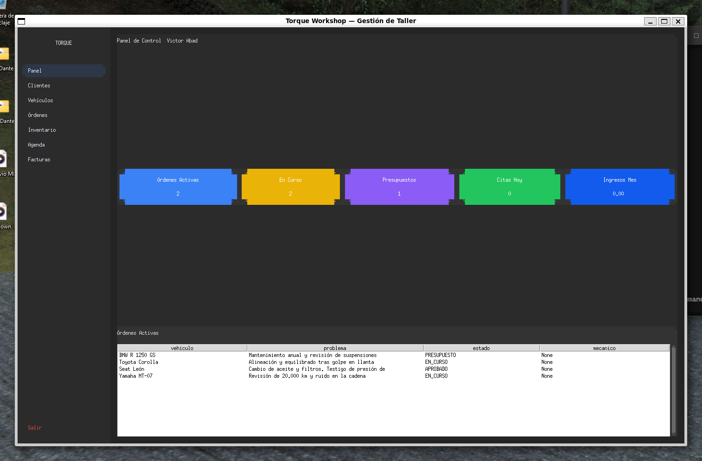
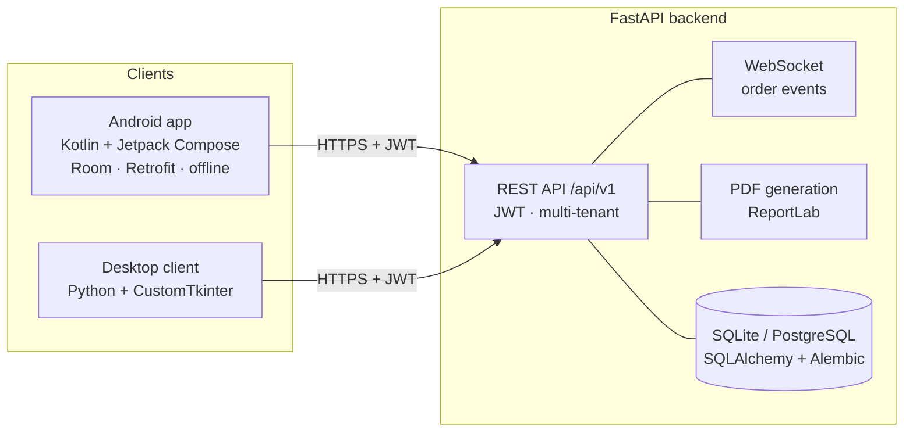
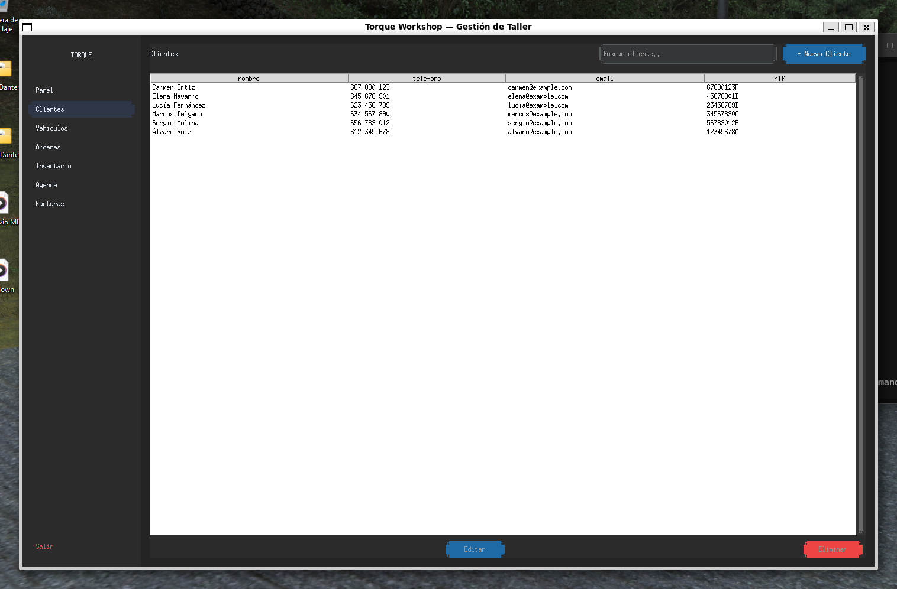
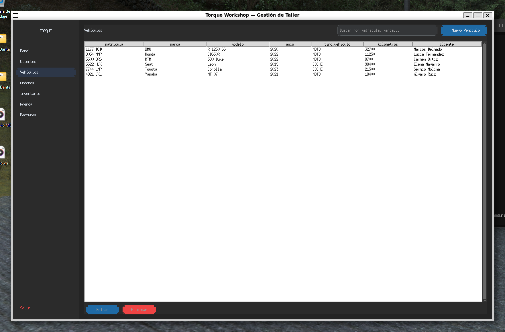
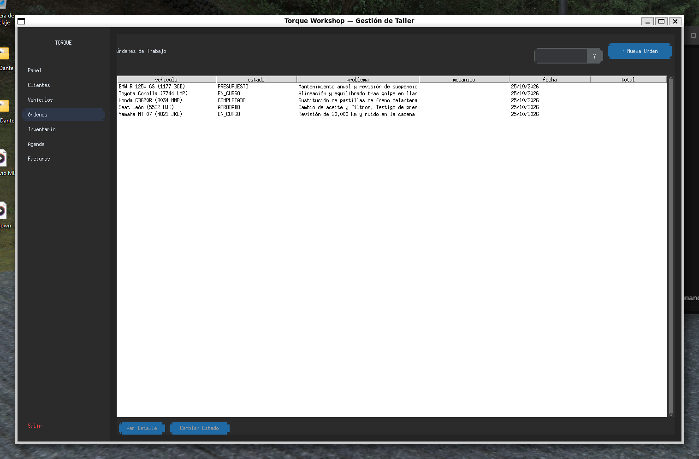

# Torque

**Workshop management system for motorcycle and car garages — Android app, desktop client and REST API.**

Torque connects the workshop office and the mechanic's phone around a single backend: manage customers, vehicles, work orders, appointments, invoices and spare-parts stock, while the Android app keeps the maintenance history and computes a per-vehicle health score offline.

[](https://github.com/VicProgram/Torque.v2/actions/workflows/ci.yml)
[](LICENSE)
[](https://kotlinlang.org/)
[](https://www.python.org/)
[](https://fastapi.tiangolo.com/)
[](https://developer.android.com/)



## Why this project

Torque started as a motorcycle-maintenance app and grew into a multi-device workshop platform. It is a full-stack playground for the things I care about as a developer:

- **Offline-first mobile data** with Room, plus background sync against a REST API.
- **A real domain algorithm**: vehicle health is computed from maintenance intervals and wear percentages, weighted per component.
- **A typed backend** with FastAPI, SQLAlchemy, JWT auth, multi-tenant isolation and WebSocket notifications.
- **A desktop client** built with CustomTkinter that consumes the same API as the Android app.
- **CI that actually runs**: detekt, unit tests and APK assembly for Android; pytest for both Python projects.

## Features

| Area | Android (mechanic) | Desktop (workshop) | API |
|---|---|---|---|
| Customers | — | CRUD, search, contact details | ✅ |
| Vehicles | Garage list, detail, photos, maintenance history | CRUD, plate search, 47 bike / 31 car brands | ✅ |
| Work orders | — | Kanban-style states, line items, PDF export | ✅ |
| Appointments | — | Agenda with states | ✅ |
| Invoices | — | Issue from work order, PDF | ✅ |
| Inventory | — | Stock, minimum stock, supplier, sale/cost price | ✅ |
| Maintenance | Intervals, wear tracking, health score, notifications | — | ✅ |
| Auth | Email/password + PIN login | Email/password | JWT |
| Order events | — | — | WebSocket channel |

### Vehicle health algorithm

Each maintenance type has a km interval, an optional day interval, a weight and a wear flag. For every vehicle Torque computes a 0–100 score:

- **Interval-based** components decay linearly with kilometres since the last service.
- **Wear-based** components use the stored wear percentage (brake pads, discs, tyres).
- The global score is the weighted average, so critical components (brakes, oil) matter more than cosmetic ones.
- The Android app produces the same result offline in the `shared` module, covered by unit tests.

## Architecture



### Modules

```
Torque.v2/
├── app/               Android UI — Jetpack Compose, activities, ViewModels
├── core/              Android domain — maintenance types, shared utilities
├── data/              Android data — Room entities, DAOs, repositories, Retrofit
├── shared/            Pure-Kotlin — health algorithm, date utils (JVM tested)
├── server/            FastAPI backend — models, schemas, routers, Alembic, tests
├── desktop-python/    CustomTkinter client — views, components, API client, tests
├── docs/              Spanish guides, architecture notes and screenshots
└── .github/           CI workflow
```

## Tech stack

| Layer | Stack |
|---|---|
| Android | Kotlin 2.1, Jetpack Compose (BOM 2025.05), Material 3, Room 2.6, Retrofit 2.11, KSP, DataStore |
| Backend | Python 3.12, FastAPI, SQLAlchemy 2, Alembic, Pydantic v2, python-jose, ReportLab, Uvicorn |
| Desktop | Python 3.12, CustomTkinter, httpx, Pillow |
| Quality | JUnit 4, pytest, Ruff, detekt, GitHub Actions |

## Getting started

### Requirements

- Python 3.12+
- JDK 17 and Android SDK 35 (Android only)
- Tkinter (bundled with Python on Windows; `python3-tk` on Linux)

### 1. Backend

```bash
make install        # create the virtualenv and install dependencies
make server         # http://localhost:8000  (Swagger at /docs)
make seed           # demo data (run while the server is up)
make test-server
```

Windows equivalents: `.\dev.ps1 install`, `.\dev.ps1 server`, `.\dev.ps1 seed`.

### 2. Desktop client

```bash
make desktop        # launch the CustomTkinter app
make test-desktop
```

### 3. Android app

```bash
./gradlew assembleDebug          # APK in app/build/outputs/apk/debug/
./gradlew testDebugUnitTest      # 114 unit tests
./gradlew detekt                 # static analysis
```

The Android client expects the API at `http://10.0.2.2:8000` from the emulator; see `docs/GUIA_DEV.md` for device configuration.

### Demo credentials

```
Email:    admin@demo.com
Password: demo1234
```

(`make seed` creates the demo workshop. The seeded brand/model catalogue is inserted by `make seed-marcas`.)

## API overview

Swagger UI is served at `http://localhost:8000/docs`. The API exposes 45 endpoints under `/api/v1`:

| Group | Endpoints |
|---|---|
| Auth | `registro-taller`, `login`, `login-pin`, `me`, `me/pin` |
| Customers | list/create/read/update/delete |
| Vehicles | CRUD, plate lookup |
| Work orders | CRUD, state transitions, line items, PDF |
| Appointments | CRUD, agenda |
| Invoices | list/create/read/delete, PDF |
| Inventory | CRUD, stock adjustment |
| Dashboard | workshop KPIs |
| Catalogue | brands by vehicle type, models per brand |

Auth is JWT-based. Every query is scoped by `id_taller`, so one deployment can host several workshops without data leaking between them.

## Screenshots

| Customers | Vehicles |
|---|---|
|  |  |

| Work orders | Dashboard |
|---|---|
|  |  |

## Tests and quality

```bash
# Backend — 16 tests
cd server && pytest

# Desktop — 4 tests
cd desktop-python && pytest

# Android — 114 unit tests (debug) + 24 shared-module tests
./gradlew testDebugUnitTest
./gradlew detekt
```

GitHub Actions runs all three suites on every push and pull request, builds the debug APK and uploads it as an artifact.

## Documentation

The in-depth documentation is written in Spanish:

- [Project guide](docs/README.es.md) — components, commands, structure
- [Development guide](docs/GUIA_DEV.md) — environment setup, troubleshooting
- [Car support plan](docs/PLAN_COCHES.md) — how the motorcycle-only model was extended to cars
- [Roadmap](docs/ROADMAP.es.md) — pending work and known tech debt

## License

[MIT](LICENSE) © 2026 Victor Abad Romero
